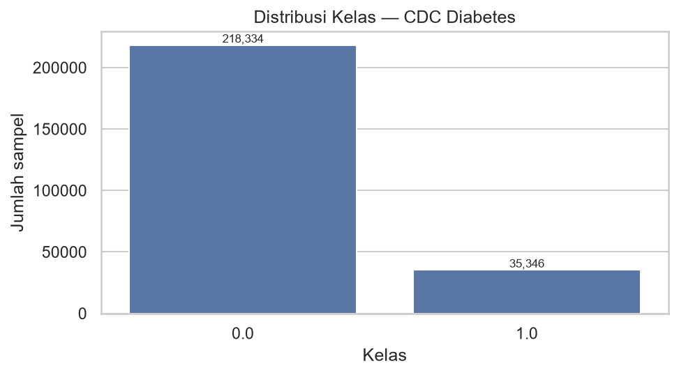
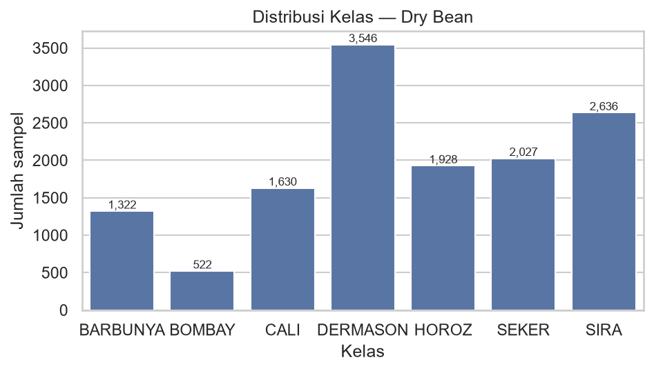
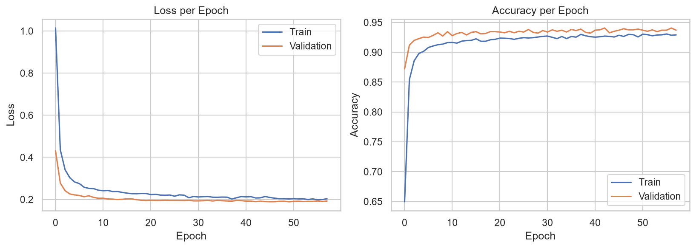
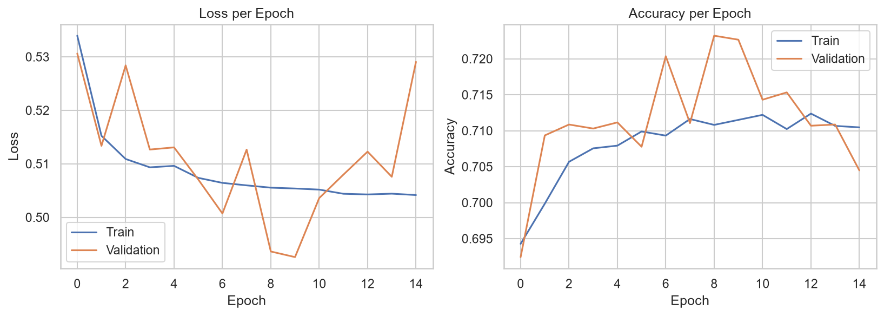
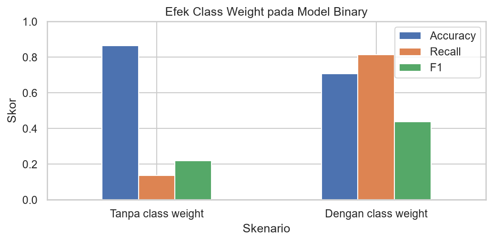
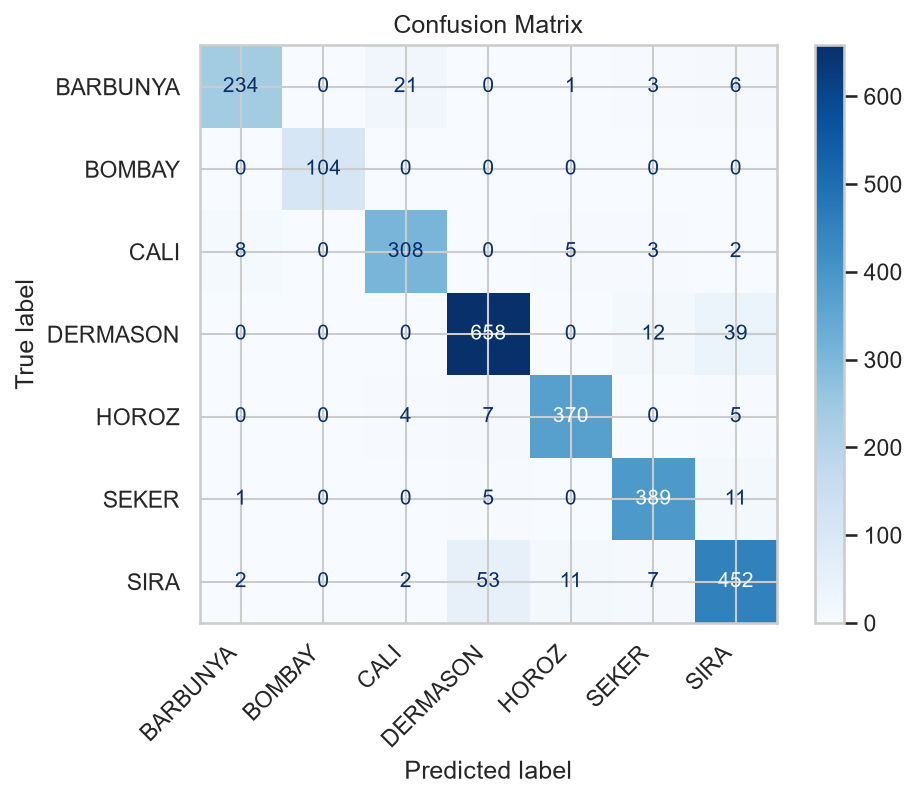
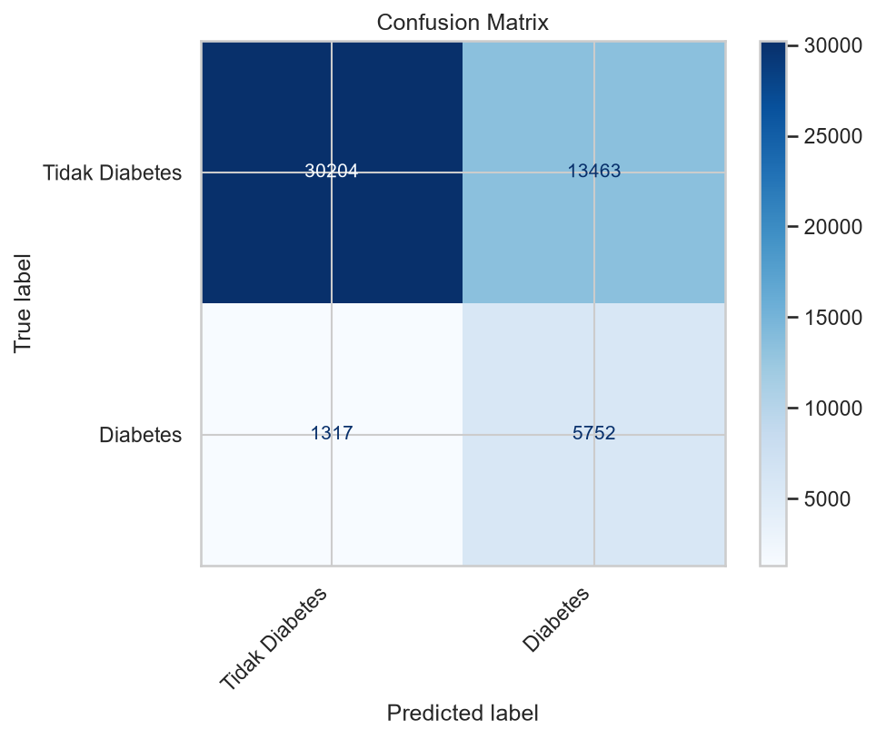

# Bab 1. Pendahuluan

## 1.1. Pemahaman Dataset

Eksperimen pada tugas besar ini menggunakan dua dataset yang telah disediakan, dipilih
untuk mewakili dua kondisi klasifikasi yang berbeda: satu dataset dengan kondisi
*binary-class* dan satu dataset dengan kondisi *multi-class*. Pemilihan dua dataset
dengan karakteristik berbeda bertujuan agar model ANN yang dibangun diuji pada dua
permasalahan yang tidak identik, sehingga kemampuan generalisasi arsitektur dapat
diamati secara lebih menyeluruh.

Seluruh dataset yang disediakan berbentuk **data tabular** (data tersusun dalam baris
dan kolom), bukan data gambar. Karena itu arsitektur yang digunakan adalah
*Multilayer Perceptron* (MLP) dengan layer `Dense`. Arsitektur *Convolutional Neural
Network* (CNN) tidak digunakan karena CNN dirancang untuk mengekstraksi pola spasial
dari data berbentuk grid seperti piksel gambar, sedangkan pada dataset ini fitur sudah
berupa nilai numerik yang telah diekstraksi sebelumnya.

### 1.1.1. Dataset Binary-class: CDC Diabetes Health Indicators

Dataset ini berasal dari *Behavioral Risk Factor Surveillance System* (BRFSS) tahun
2015 yang dikumpulkan oleh *Centers for Disease Control and Prevention* (CDC), Amerika
Serikat. Setiap baris merepresentasikan satu responden survei kesehatan, dan setiap
kolom merupakan indikator kesehatan atau demografi responden.

| Karakteristik | Nilai |
|---|---|
| Jumlah sampel | 253.680 baris |
| Jumlah kolom | 22 kolom |
| Jumlah fitur | 21 fitur |
| Kolom target | `Diabetes_binary` |
| Missing value | 0 |
| Tipe fitur | Seluruhnya numerik |

Kolom target `Diabetes_binary` hanya memiliki dua nilai, yaitu `0` untuk responden
yang tidak menderita diabetes dan `1` untuk responden yang menderita diabetes. Dengan
demikian dataset ini merupakan kasus **binary-class**.

Fitur-fitur pada dataset ini sebagian besar berupa indikator biner (bernilai 0 atau 1),
seperti `HighBP` (tekanan darah tinggi), `HighChol` (kolesterol tinggi), `Smoker`,
`Stroke`, dan `HeartDiseaseorAttack`. Beberapa fitur lain berupa nilai ordinal, seperti
`GenHlth` (persepsi kesehatan umum, skala 1--5), `Age` (kelompok usia, skala 1--13), dan
`Education` (tingkat pendidikan, skala 1--6). Hanya `BMI`, `MentHlth`, dan `PhysHlth`
yang bersifat kontinu.

**Pemilihan varian berkas.** Sumber dataset ini menyediakan tiga varian berkas, yaitu
`diabetes_binary` (253.680 baris), `diabetes_binary_5050split` (70.692 baris), dan
`diabetes_012` (253.680 baris, tiga kelas). Varian yang dipakai pada eksperimen ini
adalah `diabetes_binary` tanpa pengurangan sampel.

Varian `diabetes_binary_5050split` sengaja tidak dipakai. Berkas tersebut merupakan
subset dari varian penuh yang telah diseimbangkan secara paksa: seluruh 35.346 kasus
diabetes dipertahankan, lalu ditambahkan 35.346 kasus tidak diabetes yang diambil acak,
sehingga proporsinya menjadi 50:50. Pemakaian berkas itu akan menghilangkan kondisi
ketidakseimbangan kelas yang justru menjadi objek kajian pada Bab 3.1.3, sekaligus
membuat perbandingan dengan dan tanpa bobot kelas menjadi tidak bermakna. Selain itu,
data latih berkurang sekitar 72% tanpa menambah informasi baru. Varian `diabetes_012`
juga tidak dipakai karena targetnya terdiri atas tiga kelas, sedangkan eksperimen ini
membutuhkan satu dataset dengan kondisi *binary-class*.

**Distribusi kelas.** Dataset ini sangat tidak seimbang (*imbalanced*):

| Kelas | Keterangan | Jumlah | Persentase |
|---|---|---|---|
| 0 | Tidak diabetes | 218.334 | 86,07% |
| 1 | Diabetes | 35.346 | 13,93% |

Ketidakseimbangan dengan rasio sekitar 6:1 ini menjadi permasalahan utama pada dataset
ini. Sebuah model yang selalu menebak kelas mayoritas ("tidak diabetes") akan memperoleh
akurasi 86,07% tanpa mempelajari pola apa pun. Angka akurasi semacam itu menyesatkan,
sehingga pemilihan metrik evaluasi dan strategi penanganan ketidakseimbangan menjadi
bagian penting dari eksperimen ini.

Dengan demikian, distribusi 86,07 : 13,93 yang ditampilkan di atas adalah distribusi
asli dataset, bukan hasil rekayasa penyeimbangan.

### 1.1.2. Dataset Multi-class: Dry Bean Dataset

Dataset ini berisi hasil pengukuran geometris dari citra biji kacang kering. Meskipun
data aslinya berasal dari foto, dataset yang disediakan **bukan** berupa gambar, melainkan
fitur numerik hasil ekstraksi bentuk. Setiap baris merepresentasikan satu biji kacang,
dan setiap kolom merupakan ukuran geometris biji tersebut.

| Karakteristik | Nilai |
|---|---|
| Jumlah sampel | 13.611 baris |
| Jumlah kolom | 17 kolom |
| Jumlah fitur | 16 fitur |
| Kolom target | `Class` |
| Missing value | 0 |
| Jumlah kelas | 7 kelas |

Kolom target `Class` berisi nama jenis kacang dalam bentuk teks. Terdapat tujuh jenis
kacang yang berbeda, sehingga dataset ini merupakan kasus **multi-class**.

Fitur-fitur pada dataset ini merupakan hasil pengukuran bentuk biji, antara lain `Area`
(luas area biji), `Perimeter` (keliling), `MajorAxisLength` dan `MinorAxisLength`
(panjang sumbu mayor dan minor), `Eccentricity` (tingkat kelonjongan), `ConvexArea`
(luas selubung cembung), `Extent`, `Solidity`, serta empat *shape factor* yang merupakan
rasio antar ukuran.

**Distribusi kelas.** Dataset ini juga tidak seimbang, meskipun tidak seekstrem dataset
pertama:

| Kelas | Jumlah | Persentase |
|---|---|---|
| DERMASON | 3.546 | 26,05% |
| SIRA | 2.636 | 19,37% |
| SEKER | 2.027 | 14,89% |
| HOROZ | 1.928 | 14,16% |
| CALI | 1.630 | 11,98% |
| BARBUNYA | 1.322 | 9,71% |
| BOMBAY | 522 | 3,84% |

Kelas terbesar (DERMASON) memiliki jumlah sampel hampir tujuh kali lipat kelas terkecil
(BOMBAY).

### 1.1.3. Perbandingan Karakteristik Kedua Dataset

| Aspek | CDC Diabetes | Dry Bean |
|---|---|---|
| Kondisi klasifikasi | Binary-class | Multi-class |
| Jumlah sampel | 253.680 | 13.611 |
| Jumlah fitur | 21 | 16 |
| Jumlah kelas | 2 | 7 |
| Rasio kelas | 86,07 : 13,93 | 26,05 : 3,84 |
| Jenis fitur | Biner, ordinal, kontinu | Kontinu |
| Tingkat kesulitan | Tinggi (kelas tumpang tindih) | Sedang (ciri geometris jelas) |

Perbedaan yang paling mencolok terletak pada sifat fiturnya. Pada dataset Dry Bean,
setiap jenis kacang memiliki ukuran geometris yang khas sehingga kelas relatif mudah
dipisahkan. Sebaliknya, pada dataset Diabetes, dua responden dengan nilai BMI, tekanan
darah, dan usia yang sama dapat memiliki status diabetes yang berbeda, sehingga batas
antar kelas tidak dapat dipisahkan secara sempurna oleh fitur yang tersedia.

## 1.2. Pemrosesan Awal Dataset

Tahap pemrosesan awal dilakukan agar data siap digunakan oleh model ANN. Terdapat tiga
langkah utama yang diterapkan pada kedua dataset: pemisahan fitur dan target, pembagian
data latih dan data uji, serta standardisasi fitur. Pada dataset binary ditambahkan satu
langkah khusus berupa perhitungan bobot kelas.

### 1.2.1. Pemeriksaan Kualitas Data

Langkah pertama adalah memastikan data tidak mengandung nilai kosong dan seluruh fitur
bertipe numerik. Pemeriksaan dilakukan dengan menghitung total sel kosong menggunakan
`isna().sum().sum()` dan memeriksa keberadaan kolom non-numerik menggunakan
`select_dtypes(exclude="number")`.

| Dataset | Missing value | Fitur non-numerik |
|---|---|---|
| CDC Diabetes | 0 | Tidak ada |
| Dry Bean | 0 | Tidak ada |

Hasil ini menunjukkan bahwa tidak diperlukan penanganan nilai kosong (*imputation*)
maupun pengodean variabel kategorikal pada fitur. Satu-satunya kolom non-numerik adalah
kolom target pada dataset Dry Bean, yang ditangani secara terpisah melalui *label
encoding*.

### 1.2.2. Pemisahan Fitur dan Target

Fitur dan target dipisahkan menjadi dua variabel berbeda. Fitur disimpan pada variabel
`X` dan target pada variabel `y`. Pemisahan dilakukan dengan membuang kolom target dari
dataframe fitur.

| Dataset | Variabel fitur | Variabel target | Dimensi fitur |
|---|---|---|---|
| CDC Diabetes | `X_bin` | `y_bin` | (253.680, 21) |
| Dry Bean | `X_multi` | `y_multi` | (13.611, 16) |

### 1.2.3. Pengodean Label Target

Pada dataset Dry Bean, kolom target `Class` berisi teks nama jenis kacang. Karena ANN
hanya dapat melakukan operasi aritmetika pada angka, label teks tersebut harus diubah
menjadi representasi numerik. Proses ini dilakukan dalam dua tahap.

**Tahap pertama, *label encoding*.** Setiap nama kelas dipetakan ke bilangan bulat
0 sampai 6 menggunakan `LabelEncoder`. Pemetaan dilakukan secara alfabetis.

| Nilai | Kelas |
|---|---|
| 0 | BARBUNYA |
| 1 | BOMBAY |
| 2 | CALI |
| 3 | DERMASON |
| 4 | HOROZ |
| 5 | SEKER |
| 6 | SIRA |

**Tahap kedua, *one-hot encoding*.** Label bilangan bulat kemudian diubah menjadi
vektor biner berdimensi tujuh menggunakan `to_categorical`. Pendekatan ini diperlukan
karena label bilangan bulat menyiratkan urutan yang sebenarnya tidak ada: angka 6 tidak
berarti "lebih besar" dari angka 3, keduanya hanyalah penanda kelas yang setara.

| Label asli | Setelah label encoding | Setelah one-hot encoding |
|---|---|---|
| BARBUNYA | 0 | [1, 0, 0, 0, 0, 0, 0] |
| BOMBAY | 1 | [0, 1, 0, 0, 0, 0, 0] |
| CALI | 2 | [0, 0, 1, 0, 0, 0, 0] |
| DERMASON | 3 | [0, 0, 0, 1, 0, 0, 0] |
| HOROZ | 4 | [0, 0, 0, 0, 1, 0, 0] |
| SEKER | 5 | [0, 0, 0, 0, 0, 1, 0] |
| SIRA | 6 | [0, 0, 0, 0, 0, 0, 1] |

Dengan representasi ini, keluaran model berupa vektor probabilitas tujuh elemen dapat
dibandingkan langsung dengan label sebenarnya.

Pada dataset CDC Diabetes tidak diperlukan pengodean, karena target `Diabetes_binary`
sudah berupa angka 0 dan 1.

### 1.2.4. Pembagian Data Latih dan Data Uji

Data dibagi menjadi data latih (*training set*) dan data uji (*test set*) dengan
perbandingan 80:20. Pembagian dilakukan menggunakan `train_test_split` dengan dua
parameter penting.

Pertama, `random_state=42` ditetapkan agar pembagian data bersifat deterministik.
Tanpa nilai tetap, pembagian akan berbeda setiap kali kode dijalankan, sehingga hasil
eksperimen tidak dapat direproduksi.

Kedua, `stratify` diisi dengan variabel target agar proporsi setiap kelas tetap sama
pada data latih dan data uji. Tanpa stratifikasi, pembagian acak berisiko membuat kelas
minoritas seperti BOMBAY (3,84%) tidak terwakili secara proporsional pada data uji,
sehingga hasil evaluasi menjadi tidak representatif.

| Dataset | Data latih | Data uji | Total |
|---|---|---|---|
| CDC Diabetes | 202.944 | 50.736 | 253.680 |
| Dry Bean | 10.888 | 2.723 | 13.611 |

Distribusi per kelas setelah pembagian pada dataset Dry Bean:

| Kelas | Data latih | Data uji |
|---|---|---|
| BARBUNYA | 1.057 | 265 |
| BOMBAY | 418 | 104 |
| CALI | 1.304 | 326 |
| DERMASON | 2.837 | 709 |
| HOROZ | 1.542 | 386 |
| SEKER | 1.621 | 406 |
| SIRA | 2.109 | 527 |

Proporsi setiap kelas terjaga pada kedua bagian data, sesuai dengan tujuan stratifikasi.

### 1.2.5. Standardisasi Fitur

Standardisasi dilakukan menggunakan `StandardScaler`, yang mentransformasi setiap fitur
sehingga memiliki rata-rata 0 dan simpangan baku 1. Rumus yang digunakan adalah:

$$z = \frac{x - \mu}{\sigma}$$

dengan $x$ adalah nilai asli, $\mu$ adalah rata-rata fitur, dan $\sigma$ adalah simpangan
baku fitur.

Standardisasi merupakan langkah wajib pada dataset Dry Bean karena rentang nilai antar
fitur sangat jauh berbeda. Fitur `Area` memiliki nilai hingga 251.082, sedangkan
`ShapeFactor2` hanya bernilai sekitar 0,0006. Tanpa standardisasi, fitur dengan rentang
besar akan mendominasi perhitungan gradien, sehingga fitur dengan rentang kecil hampir
tidak berkontribusi terhadap proses pembelajaran.

| Dataset | Sebelum standardisasi | Sesudah standardisasi |
|---|---|---|
| Dry Bean | min 0,000567 \quad max 251.082 | min -14,467 \quad max 6,672 |
| CDC Diabetes | nilai biner dan ordinal | min -5,061 \quad max 10,552 |

Sebagai contoh konkret, rata-rata tiga fitur pada data latih Dry Bean sebelum dan
sesudah standardisasi:

| Fitur | Rata-rata sebelum | Rata-rata sesudah |
|---|---|---|
| Area | 53.018,0726 | 0,0000 |
| ShapeFactor2 | 0,0017 | 0,0000 |
| Compactness | 0,7999 | 0,0000 |

**Pencegahan kebocoran data.** Terdapat satu aturan penting dalam standardisasi:
parameter $\mu$ dan $\sigma$ **hanya boleh dihitung dari data latih**. Pada kode,
hal ini diwujudkan dengan memanggil `fit_transform()` pada data latih, tetapi hanya
`transform()` pada data uji.

Alasan aturan ini bersifat mutlak adalah sebagai berikut. Apabila data uji ikut
digunakan dalam perhitungan $\mu$ dan $\sigma$, model secara tidak langsung telah
mengetahui informasi statistik dari data yang seharusnya belum pernah dilihatnya.
Kondisi ini disebut *data leakage*, dan akibatnya hasil evaluasi menjadi terlalu
optimistis serta tidak mencerminkan performa model pada data baru.

Verifikasi dilakukan dengan memeriksa atribut `n_samples_seen_` pada scaler:

| Scaler | Jumlah sampel yang dipakai | Jumlah data latih | Status |
|---|---|---|---|
| Scaler binary | 202.944 | 202.944 | Sesuai |
| Scaler multi | 10.888 | 10.888 | Sesuai |

Kedua scaler terbukti hanya di-*fit* menggunakan data latih, sehingga tidak terjadi
kebocoran data.

### 1.2.6. Perhitungan Bobot Kelas

Langkah tambahan ini hanya diterapkan pada dataset CDC Diabetes. Karena rasio kelas
mencapai 86,07 : 13,93, model berisiko mengabaikan kelas minoritas dan hanya belajar
menebak kelas mayoritas.

Bobot kelas dihitung menggunakan `compute_class_weight` dengan parameter
`class_weight="balanced"`. Fungsi ini memberikan bobot berbanding terbalik dengan
frekuensi kelas: kelas yang jarang muncul mendapat bobot lebih besar.

| Kelas | Jumlah di data latih | Bobot |
|---|---|---|
| 0 (Tidak diabetes) | 174.667 | 0,5809 |
| 1 (Diabetes) | 28.277 | 3,5885 |

Bobot kelas 1 sekitar **6,18 kali** lebih besar daripada kelas 0. Secara konseptual,
bobot ini memberi tahu model bahwa kesalahan dalam mengklasifikasikan satu penderita
diabetes sebagai orang sehat harus "dihukum" sekitar enam kali lebih berat dibandingkan
kesalahan sebaliknya. Konsekuensi dari strategi ini dibahas pada Bab 3.

\newpage

# Bab 2. Landasan Teori

## 2.1. Penjelasan Metode dan Model Learning

### 2.1.1. Artificial Neural Network

*Artificial Neural Network* (ANN) adalah model pembelajaran mesin yang terinspirasi
oleh cara kerja jaringan neuron biologis. ANN tersusun dari sejumlah unit komputasi
yang disebut **neuron** atau **node**, yang diorganisasikan dalam beberapa **layer**
dan dihubungkan oleh **bobot** (*weight*) yang dapat disesuaikan.

Setiap neuron menerima sejumlah masukan $x_1, x_2, \ldots, x_n$, mengalikannya dengan
bobot $w_1, w_2, \ldots, w_n$, menjumlahkannya, menambahkan sebuah nilai bias $b$, lalu
meneruskan hasilnya melalui sebuah **fungsi aktivasi** $f$:

$$y = f\left(\sum_{i=1}^{n} w_i x_i + b\right)$$

Proses pembelajaran ANN adalah proses mencari nilai bobot dan bias yang membuat
keluaran model sedekat mungkin dengan nilai yang sebenarnya. Pencarian ini dilakukan
secara iteratif menggunakan algoritma *gradient descent* dan *backpropagation*.

### 2.1.2. Arsitektur Multilayer Perceptron

Arsitektur yang digunakan pada eksperimen ini adalah *Multilayer Perceptron* (MLP),
yaitu ANN yang tersusun dari tiga jenis layer:

**Layer masukan (*input layer*)** menerima vektor fitur dari data. Jumlah neuron pada
layer ini sama dengan jumlah fitur dataset, dan layer ini tidak melakukan komputasi
selain meneruskan nilai masukan.

**Layer tersembunyi (*hidden layer*)** melakukan transformasi non-linear terhadap
representasi data. Setiap layer tersembunyi terdiri dari sejumlah neuron yang masing-masing
terhubung penuh (*fully connected*) ke seluruh neuron pada layer sebelumnya. Jumlah
layer dan jumlah neuron per layer merupakan **hyperparameter** yang ditentukan oleh
perancang model.

**Layer keluaran (*output layer*)** menghasilkan prediksi akhir. Jumlah neuron pada
layer ini bergantung pada jenis permasalahan klasifikasi yang dihadapi.

### 2.1.3. Fungsi Aktivasi

Fungsi aktivasi berperan memasukkan sifat non-linear ke dalam jaringan. Tanpa fungsi
aktivasi, susunan beberapa layer akan ekuivalen dengan satu transformasi linear saja,
sehingga kedalaman jaringan menjadi tidak bermakna.

**ReLU (*Rectified Linear Unit*)** digunakan pada layer tersembunyi. Fungsi ini
didefinisikan sebagai:

$$f(x) = \max(0, x)$$

ReLU dipilih karena komputasinya sederhana dan tidak mengalami masalah *vanishing
gradient* sebagaimana yang sering terjadi pada fungsi sigmoid ketika jaringan memiliki
banyak layer.

**Sigmoid** digunakan pada layer keluaran untuk kasus binary-class. Fungsi ini
memetakan nilai apa pun ke rentang antara 0 dan 1:

$$\sigma(x) = \frac{1}{1 + e^{-x}}$$

Keluaran sigmoid dapat ditafsirkan sebagai probabilitas keanggotaan pada kelas positif.
Dengan satu neuron keluaran, nilai 0,84 berarti model memperkirakan probabilitas 84%
bahwa data tersebut termasuk kelas 1.

**Softmax** digunakan pada layer keluaran untuk kasus multi-class. Fungsi ini
mentransformasi vektor $z$ berdimensi $K$ menjadi vektor probabilitas yang totalnya
sama dengan 1:

$$\text{softmax}(z)_i = \frac{e^{z_i}}{\sum_{j=1}^{K} e^{z_j}}$$

Softmax diperlukan karena pada kasus multi-class, kelas-kelas bersifat saling
meniadakan (*mutually exclusive*). Jika sigmoid digunakan pada tujuh neuron keluaran,
masing-masing neuron akan menghasilkan nilai 0--1 secara independen, sehingga totalnya
bisa melebihi 1 dan tidak lagi bermakna sebagai probabilitas.

### 2.1.4. Fungsi Kerugian

Fungsi kerugian (*loss function*) mengukur seberapa jauh prediksi model dari nilai
sebenarnya. Nilai kerugian inilah yang diminimalkan selama proses pelatihan.

**Binary cross-entropy** digunakan untuk kasus binary-class:

$$L = -\frac{1}{N}\sum_{i=1}^{N}\left[y_i \log(\hat{y}_i) + (1-y_i)\log(1-\hat{y}_i)\right]$$

**Categorical cross-entropy** digunakan untuk kasus multi-class:

$$L = -\frac{1}{N}\sum_{i=1}^{N}\sum_{k=1}^{K} y_{ik} \log(\hat{y}_{ik})$$

Kedua fungsi kerugian ini merupakan pasangan yang sesuai dengan fungsi aktivasi
keluarannya. Penggunaan sigmoid dengan categorical cross-entropy, atau softmax dengan
binary cross-entropy, akan menghasilkan proses pembelajaran yang tidak stabil.

### 2.1.5. Optimizer Adam

*Adaptive Moment Estimation* (Adam) adalah algoritma optimasi yang menyesuaikan laju
pembelajaran (*learning rate*) secara individual untuk setiap parameter. Adam menyimpan
rata-rata bergerak dari gradien (momen pertama) dan rata-rata bergerak dari kuadrat
gradien (momen kedua), lalu menggunakan keduanya untuk menentukan besar langkah
pembaruan setiap bobot.

Adam dipilih karena konvergensinya relatif cepat dan tidak terlalu sensitif terhadap
pemilihan laju pembelajaran awal. Pada eksperimen ini digunakan laju pembelajaran 0,001.

### 2.1.6. Dropout

*Dropout* adalah teknik regularisasi yang secara acak "mematikan" sebagian neuron
selama proses pelatihan. Pada setiap langkah pelatihan, setiap neuron memiliki
probabilitas $p$ untuk diabaikan sementara.

Teknik ini mencegah model menjadi terlalu bergantung pada neuron tertentu, sehingga
model dipaksa mempelajari representasi yang lebih tersebar dan tahan terhadap
*overfitting*. Pada eksperimen ini digunakan $p = 0,2$, artinya 20% neuron dimatikan
secara acak pada setiap langkah pelatihan.

Perlu dicatat bahwa dropout hanya aktif selama pelatihan. Pada saat pengujian, seluruh
neuron diaktifkan kembali. Hal ini menjelaskan mengapa akurasi pada data validasi dapat
lebih tinggi daripada akurasi pada data latih, sebagaimana akan terlihat pada Bab 3.

### 2.1.7. Early Stopping

*Early stopping* adalah teknik untuk menghentikan pelatihan sebelum jumlah epoch yang
direncanakan tercapai, apabila performa pada data validasi tidak lagi menunjukkan
perbaikan.

Mekanisme kerjanya adalah sebagai berikut. Nilai kerugian validasi dipantau pada setiap
epoch. Apabila nilai tersebut tidak menurun selama sejumlah epoch berturut-turut
(parameter `patience`), pelatihan dihentikan. Dengan `restore_best_weights=True`, bobot
model dikembalikan ke kondisi terbaik yang pernah dicapai, bukan kondisi pada epoch
terakhir.

Teknik ini mencegah *overfitting* yang terjadi ketika model mulai menghafal data latih
alih-alih mempelajari pola umum.

### 2.1.8. Bobot Kelas

*Class weight* adalah teknik penanganan data tidak seimbang yang diterapkan pada fungsi
kerugian. Setiap kesalahan klasifikasi dikalikan dengan bobot kelas dari data yang
salah diklasifikasikan tersebut.

Dengan pemberian bobot berbanding terbalik terhadap frekuensi kelas, kesalahan pada
kelas minoritas menjadi "lebih mahal" secara matematis. Akibatnya, model terdorong
untuk lebih memperhatikan kelas minoritas, meskipun harus mengorbankan sebagian
akurasi keseluruhan.

### 2.1.9. Metrik Evaluasi

**Accuracy** mengukur proporsi prediksi yang benar terhadap total prediksi:

$$\text{Accuracy} = \frac{TP + TN}{TP + TN + FP + FN}$$

**Precision** mengukur proporsi data yang benar-benar positif di antara semua data yang
diprediksi positif:

$$\text{Precision} = \frac{TP}{TP + FP}$$

**Recall** (atau *sensitivity*) mengukur proporsi data positif yang berhasil ditemukan
di antara semua data yang sebenarnya positif:

$$\text{Recall} = \frac{TP}{TP + FN}$$

**F1-score** adalah rata-rata harmonik dari precision dan recall:

$$F1 = 2 \times \frac{\text{Precision} \times \text{Recall}}{\text{Precision} + \text{Recall}}$$

Rata-rata harmonik digunakan, bukan rata-rata aritmetika, karena rata-rata harmonik
memberi penalti lebih besar apabila salah satu nilai sangat rendah. Dengan demikian,
F1-score tinggi hanya dapat dicapai apabila precision dan recall keduanya tinggi.

**ROC-AUC** (*Area Under the Receiver Operating Characteristic Curve*) mengukur
kemampuan model membedakan kelas positif dan negatif pada berbagai nilai threshold.
Nilai 1,0 menyatakan pemisahan sempurna, sedangkan 0,5 menyatakan performa setara
tebakan acak. Berbeda dengan metrik lain, ROC-AUC tidak bergantung pada pemilihan
threshold tertentu, sehingga cocok digunakan pada data yang tidak seimbang.

Pada kasus multi-class, digunakan rata-rata **macro**, yaitu rata-rata skor setiap
kelas tanpa mempertimbangkan jumlah sampel per kelas. Pendekatan ini lebih jujur
dibandingkan rata-rata *weighted* pada data tidak seimbang, karena kelas kecil seperti
BOMBAY memperoleh bobot yang sama dengan kelas besar seperti DERMASON.

## 2.2. Skema Eksperimen dalam ANN Learning

### 2.2.1. Konfigurasi Umum

Kedua model dibangun menggunakan satu fungsi yang sama, yaitu `build_ann()`, agar
struktur keduanya konsisten dan perbedaan hanya terletak pada konfigurasi keluaran.
Fungsi ini menerima parameter dimensi masukan, dimensi keluaran, susunan neuron pada
layer tersembunyi, tingkat dropout, dan fungsi aktivasi keluaran.

| Komponen | Konfigurasi umum |
|---|---|
| Arsitektur | Multilayer Perceptron (fully connected) |
| Layer tersembunyi | 2 layer: 64 neuron dan 32 neuron |
| Aktivasi layer tersembunyi | ReLU |
| Regularisasi | Dropout 0,2 pada setiap layer tersembunyi |
| Optimizer | Adam, learning rate 0,001 |
| Validation split | 15% dari data latih |
| Batch size (multi) | 64 |
| Batch size (binary) | 256 |
| Early stopping patience | 8 (multi), 5 (binary) |

### 2.2.2. Konfigurasi Model Multi-class

| Komponen | Nilai |
|---|---|
| Dataset | Dry Bean |
| Dimensi masukan | 16 |
| Susunan layer | 16 $\rightarrow$ 64 $\rightarrow$ 32 $\rightarrow$ 7 |
| Aktivasi keluaran | Softmax |
| Fungsi kerugian | Categorical cross-entropy |
| Maksimum epoch | 60 |
| Jumlah parameter | 3.399 |
| Class weight | Tidak digunakan |

Perhitungan jumlah parameter:

- Layer 1: $(16 \times 64) + 64 = 1.088$ parameter
- Layer 2: $(64 \times 32) + 32 = 2.080$ parameter
- Layer 3: $(32 \times 7) + 7 = 231$ parameter
- Total: $1.088 + 2.080 + 231 = 3.399$ parameter

### 2.2.3. Konfigurasi Model Binary

| Komponen | Nilai |
|---|---|
| Dataset | CDC Diabetes |
| Dimensi masukan | 21 |
| Susunan layer | 21 $\rightarrow$ 64 $\rightarrow$ 32 $\rightarrow$ 1 |
| Aktivasi keluaran | Sigmoid |
| Fungsi kerugian | Binary cross-entropy |
| Maksimum epoch | 40 |
| Jumlah parameter | 3.521 |
| Class weight | Ya (0,5809 dan 3,5885) |

Perhitungan jumlah parameter:

- Layer 1: $(21 \times 64) + 64 = 1.408$ parameter
- Layer 2: $(64 \times 32) + 32 = 2.080$ parameter
- Layer 3: $(32 \times 1) + 1 = 33$ parameter
- Total: $1.408 + 2.080 + 33 = 3.521$ parameter

### 2.2.4. Ringkasan Perbedaan Konfigurasi

| Aspek | Multi-class (Dry Bean) | Binary (CDC Diabetes) |
|---|---|---|
| Neuron keluaran | 7 | 1 |
| Aktivasi keluaran | Softmax | Sigmoid |
| Fungsi kerugian | Categorical cross-entropy | Binary cross-entropy |
| Bentuk target | One-hot (7 kolom) | Skalar (0 atau 1) |
| Pengambilan keputusan | `argmax` dari 7 probabilitas | Threshold 0,5 |
| Class weight | Tidak | Ya |
| Batch size | 64 | 256 |

Perbedaan batch size ditetapkan karena ukuran dataset berbeda jauh. Dataset CDC
Diabetes memiliki 202.944 baris data latih, sekitar 19 kali lebih besar daripada data
latih Dry Bean. Penggunaan batch size 256 mempercepat pelatihan tanpa mengorbankan
kualitas konvergensi.

### 2.2.5. Alur Eksperimen

Alur eksperimen yang dijalankan pada notebook adalah sebagai berikut:

1. Memuat dataset dan memeriksa dimensi serta tipe data
2. Memisahkan fitur dan target, lalu memeriksa kualitas data
3. Melakukan pengodean label (khusus multi-class)
4. Membagi data menjadi data latih dan data uji dengan stratifikasi
5. Melakukan standardisasi fitur
6. Menghitung bobot kelas (khusus binary)
7. Membangun arsitektur model ANN
8. Melakukan kompilasi dan pelatihan model
9. Memvisualisasikan riwayat pelatihan (*loss* dan *accuracy* per epoch)
10. Melakukan prediksi pada data uji
11. Menghitung metrik evaluasi dan confusion matrix
12. Menyimpan model, scaler, dan hasil metrik

### 2.2.6. Skenario Eksperimen Tambahan

Selain model utama, dijalankan tiga skenario tambahan untuk memperoleh pemahaman yang
lebih mendalam:

**Skenario A — Perbandingan dengan dan tanpa bobot kelas.** Model binary dilatih ulang
tanpa `class_weight` untuk mengukur pengaruh strategi penanganan data tidak seimbang.

**Skenario B — Perbandingan arsitektur.** Model multi-class dilatih dengan tiga susunan
layer berbeda (64-32, 128-64, dan 128-64-32) untuk mengamati pengaruh kedalaman dan
lebar jaringan.

**Skenario C — Optimasi threshold.** Nilai threshold keputusan model binary divariasikan
dari 0,30 hingga 0,80 untuk mengamati pergeseran trade-off antara precision dan recall.

Pada Skenario C, penentuan threshold terbaik dilakukan menggunakan **data validasi**,
bukan data uji. Data validasi diambil dari 15% bagian akhir data latih. Hal ini penting
agar hasil evaluasi akhir pada data uji tetap jujur: apabila threshold dipilih
berdasarkan data uji, maka data uji telah ikut berperan dalam proses pengambilan
keputusan, sehingga hasil evaluasinya tidak lagi mencerminkan performa pada data yang
benar-benar belum pernah dilihat.

\newpage

# Bab 3. Hasil Eksperimen dan Pembahasan

## 3.1. Hasil Pelatihan Model ANN

### 3.1.1. Pelatihan Model Multi-class (Dry Bean)

Model multi-class dilatih dengan maksimum 60 epoch dan early stopping dengan
`patience=8`. Pelatihan berhenti pada epoch ke-36 karena nilai loss validasi tidak
membaik selama delapan epoch berturut-turut. Loss validasi terendah dicapai pada
epoch ke-28, sehingga bobot model dikembalikan ke kondisi epoch tersebut.

Ringkasan perkembangan pelatihan pada beberapa epoch kunci:

| Epoch | Acc. latih | Acc. validasi | Loss latih | Loss validasi |
|---|---|---|---|---|
| 1 | 0,6427 | 0,8770 | 1,0320 | 0,4497 |
| 2 | 0,8536 | 0,9223 | 0,4476 | 0,2770 |
| 3 | 0,8866 | 0,9223 | 0,3356 | 0,2385 |
| 5 | 0,8981 | 0,9259 | 0,2896 | 0,2186 |
| 10 | 0,9207 | 0,9284 | 0,2405 | 0,1989 |
| 20 | 0,9210 | 0,9308 | 0,2188 | 0,1917 |
| **28** | **0,9248** | **0,9345** | **0,2130** | **0,1893** |
| 30 | 0,9247 | 0,9333 | 0,2141 | 0,1896 |
| 36 | 0,9279 | 0,9266 | 0,2046 | 0,1950 |

Dari tabel tersebut dapat diamati tiga hal penting.

**Pertama, konvergensi terjadi sangat cepat.** Pada epoch pertama, akurasi latih baru
mencapai 0,6427, tetapi pada epoch kelima sudah melonjak ke 0,8981. Sebagian besar
pembelajaran terjadi dalam lima epoch pertama.

**Kedua, terjadi *diminishing returns* yang sangat jelas.** Kenaikan akurasi validasi
pada setiap rentang epoch adalah sebagai berikut:

| Rentang epoch | Kenaikan akurasi validasi |
|---|---|
| 1 $\rightarrow$ 5 | +4,89 poin persen |
| 5 $\rightarrow$ 10 | +0,25 poin persen |
| 10 $\rightarrow$ 28 | +0,61 poin persen |
| 28 $\rightarrow$ 36 | -0,79 poin persen |

Setelah epoch ke-10, akurasi validasi bergerak mendatar di kisaran 0,93. Kenaikan
18 epoch berikutnya (epoch 10 ke epoch 28) hanya sebesar 0,61 poin persen, dan setelah
itu nilainya justru menurun. Ini menunjukkan bahwa model telah mencapai batas
kemampuannya dalam menangkap pola dari data yang tersedia.

**Ketiga, akurasi validasi lebih tinggi daripada akurasi latih.** Sebagai contoh pada
epoch 28, akurasi latih 0,9248 sedangkan akurasi validasi 0,9345. Kondisi ini bukan
merupakan kesalahan, melainkan konsekuensi langsung dari penggunaan dropout. Selama
pelatihan, 20% neuron dimatikan secara acak sehingga model bekerja dalam kondisi yang
lebih sulit. Pada saat validasi, seluruh neuron diaktifkan sehingga performa model
meningkat.

Grafik di atas menunjukkan bahwa kurva loss latih dan loss validasi bergerak berdekatan
selama 28 epoch pertama, dengan celah yang tidak melebar. Pola ini menandakan bahwa
model belum mengalami overfitting berat. Namun setelah epoch ke-28, kurva loss validasi
mulai bergerak mendatar dan sedikit menanjak, sementara kurva loss latih masih turun.
Selisih keduanya yang kembali melebar inilah yang dideteksi oleh early stopping sebagai
awal overfitting, sehingga pelatihan dihentikan pada epoch ke-36.

### 3.1.2. Pelatihan Model Binary (CDC Diabetes)

Model binary dilatih dengan maksimum 40 epoch dan early stopping dengan `patience=5`.
Pelatihan terhenti pada epoch ke-8, dan bobot dikembalikan ke kondisi terbaik yang
dicapai pada epoch ke-3.

| Epoch | Acc. latih | Acc. validasi | Loss latih | Loss validasi |
|---|---|---|---|---|
| 1 | 0,6975 | 0,7047 | 0,5292 | 0,5187 |
| 2 | 0,7046 | 0,7171 | 0,5134 | 0,5108 |
| **3** | **0,7090** | **0,7169** | **0,5106** | **0,4972** |
| 4 | 0,7089 | 0,7098 | 0,5088 | 0,5127 |
| 5 | 0,7080 | 0,7161 | 0,5073 | 0,5018 |
| 6 | 0,7101 | 0,7136 | 0,5075 | 0,5015 |
| 7 | 0,7116 | 0,7147 | 0,5059 | 0,5048 |
| 8 | 0,7126 | 0,7105 | 0,5056 | 0,5204 |

Perilaku pelatihan model ini berbeda dari model multi-class. Loss validasi mencapai
titik terendah pada epoch ke-3 (0,4972), lalu **naik** kembali hingga 0,5204 pada epoch
ke-8, sementara loss latih terus menurun secara perlahan dari 0,5292 ke 0,5056. Pola
ini merupakan tanda awal *overfitting*: model mulai menghafal data latih dan kehilangan
kemampuan generalisasi.

Early stopping bekerja tepat pada kondisi ini. Pelatihan dihentikan pada epoch ke-8,
dan bobot dikembalikan ke kondisi epoch ke-3 yang memiliki loss validasi terendah.
Dengan demikian, model yang dievaluasi pada Bab 3.2 adalah model pada epoch ke-3,
bukan model pada epoch ke-8 yang performanya lebih buruk.

Perlu diperhatikan bahwa akurasi yang dicapai model ini hanya sekitar 0,71, jauh di
bawah angka 0,86 yang dapat dicapai oleh model yang selalu menebak kelas mayoritas.
Rendahnya akurasi ini bukan merupakan kegagalan, melainkan **konsekuensi yang disengaja**
dari penerapan bobot kelas. Penjelasan lengkapnya disajikan pada Bab 3.1.3.

Grafik model binary menunjukkan kurva yang jauh lebih berfluktuasi dibandingkan model
multi-class, terutama pada kurva validasi. Fluktuasi ini wajar terjadi karena dua hal:
pertama, bobot kelas membuat distribusi kesalahan tidak seimbang; kedua, data validasi
diambil dari 15% data latih yang masih sangat tidak seimbang, sehingga satu perubahan
kecil pada prediksi kelas minoritas berdampak besar terhadap nilai loss.

### 3.1.3. Pengaruh Bobot Kelas terhadap Pelatihan

Untuk mengukur dampak nyata dari strategi bobot kelas, model binary dilatih ulang
dengan konfigurasi identik tetapi tanpa `class_weight`. Kedua model kemudian diuji pada
data uji yang sama.

| Metrik | Tanpa class weight | Dengan class weight | Perubahan |
|---|---|---|---|
| Accuracy | 0,8649 | 0,7133 | -0,1516 |
| Recall | 0,1508 | **0,8025** | **+0,6517** |
| F1-score | 0,2372 | 0,4382 | +0,2010 |

Hasil ini merupakan temuan paling penting pada eksperimen binary. Penjelasannya
adalah sebagai berikut.

Model **tanpa** bobot kelas memperoleh akurasi tinggi (86,49%) karena model tersebut
menemukan strategi termudah: menebak hampir semua data sebagai kelas mayoritas ("tidak
diabetes"). Akurasi tinggi ini menyesatkan, karena recall-nya hanya **0,1508**. Artinya,
dari 100 penderita diabetes, hanya **15 orang** yang berhasil terdeteksi, sementara
**85 orang lainnya lolos** tanpa teridentifikasi.

Model **dengan** bobot kelas menghasilkan akurasi lebih rendah (71,33%), tetapi
recall-nya melonjak menjadi **0,8025**. Artinya, dari 100 penderita diabetes, **80 orang**
berhasil terdeteksi.

Apabila hanya melihat angka akurasi, model tanpa bobot kelas tampak lebih baik. Namun
untuk konteks skrining kesehatan, kesimpulan tersebut keliru. Keberhasilan sebuah model
skrining tidak diukur dari seberapa sering model menjawab benar secara keseluruhan,
melainkan dari seberapa kecil kemungkinan penderita penyakit lolos tanpa terdeteksi.

### 3.1.4. Pengaruh Arsitektur terhadap Performa

Untuk menguji apakah performa model multi-class dapat ditingkatkan melalui perubahan
arsitektur, dilakukan pelatihan dengan tiga susunan layer berbeda. Seluruh konfigurasi
lain dipertahankan identik.

| Arsitektur | Accuracy | Selisih terhadap baseline |
|---|---|---|
| 64-32 (baseline) | 0,9251 | — |
| **128-64** | **0,9273** | **+0,22 poin persen** |
| 128-64-32 | 0,9218 | -0,33 poin persen |

Hasil ini menunjukkan dua hal.

**Pertama, penambahan lebar jaringan memberi perbaikan yang sangat kecil.** Memperbesar
layer dari 64-32 menjadi 128-64 hanya menaikkan akurasi sebesar 0,22 poin persen.
Kenaikan sekecil ini berada dalam rentang variasi acak yang dapat muncul hanya karena
perbedaan inisialisasi bobot awal.

**Kedua, penambahan kedalaman jaringan justru menurunkan performa.** Arsitektur tiga
layer tersembunyi (128-64-32) menghasilkan akurasi 0,9218, lebih rendah 0,33 poin persen
daripada baseline dua layer. Dengan hanya 10.888 data latih dan 16 fitur, jaringan yang
lebih dalam memiliki kapasitas berlebih (*overcapacity*) sehingga cenderung menghafal
data latih.

Kesimpulan dari eksperimen ini adalah bahwa **performa model dibatasi oleh kualitas
informasi pada data, bukan oleh kapasitas model**. Menambah neuron atau layer tidak
dapat menciptakan informasi yang tidak ada pada fitur. Batas performa yang wajar untuk
dataset Dry Bean berada pada kisaran 0,92--0,93, dan model baseline sudah berada di
dalam kisaran tersebut.

## 3.2. Hasil Pengujian Model ANN

### 3.2.1. Hasil Pengujian Model Multi-class (Dry Bean)

Model multi-class diuji pada 2.723 data uji yang belum pernah dilihat selama pelatihan.
Prediksi ditentukan dengan mengambil indeks probabilitas tertinggi (*argmax*) dari
tujuh nilai keluaran softmax.

**Metrik evaluasi keseluruhan:**

| Metrik | Nilai |
|---|---|
| Accuracy | 0,9225 |
| Precision (macro) | 0,9370 |
| Recall (macro) | 0,9332 |
| F1-score (macro) | 0,9350 |
| ROC-AUC (OvR, macro) | 0,9952 |

Model mencapai akurasi **92,25%**, yang berarti dari 2.723 data uji, sekitar 2.512 data
berhasil diklasifikasikan dengan benar.

**Metrik per kelas:**

| Kelas | Precision | Recall | F1-score | Jumlah data uji |
|---|---|---|---|---|
| BARBUNYA | 0,94 | 0,89 | 0,92 | 265 |
| BOMBAY | 1,00 | 1,00 | 1,00 | 104 |
| CALI | 0,94 | 0,94 | 0,94 | 326 |
| DERMASON | 0,90 | 0,92 | 0,91 | 709 |
| HOROZ | 0,96 | 0,96 | 0,96 | 386 |
| SEKER | 0,94 | 0,96 | 0,95 | 406 |
| SIRA | 0,87 | 0,85 | 0,86 | 527 |

**Confusion matrix** (baris menyatakan kelas aktual, kolom menyatakan kelas prediksi;
BAR = BARBUNYA, BOM = BOMBAY, CAL = CALI, DER = DERMASON, HOR = HOROZ, SEK = SEKER,
SIR = SIRA):

| Aktual | BAR | BOM | CAL | DER | HOR | SEK | SIR |
|:-------------------|----:|----:|----:|----:|----:|----:|----:|
| BARBUNYA | **237** | 0 | 17 | 0 | 1 | 4 | 6 |
| BOMBAY | 0 | **104** | 0 | 0 | 0 | 0 | 0 |
| CALI | 9 | 0 | **308** | 0 | 5 | 2 | 2 |
| DERMASON | 0 | 0 | 0 | **655** | 0 | 10 | 44 |
| HOROZ | 1 | 0 | 2 | 5 | **372** | 0 | 6 |
| SEKER | 2 | 0 | 0 | 6 | 0 | **388** | 10 |
| SIRA | 2 | 0 | 1 | 60 | 9 | 7 | **448** |

Dari confusion matrix tersebut dapat ditarik beberapa temuan.

**BOMBAY terklasifikasi sempurna.** Seluruh 104 data BOMBAY berhasil dikenali tanpa
satu pun kesalahan. Hal ini wajar karena BOMBAY adalah varietas dengan ukuran paling
kecil dan bentuk paling khas, sehingga sangat berbeda secara geometris dari enam kelas
lainnya.

**SIRA merupakan kelas tersulit.** Dari 527 data SIRA, sebanyak 60 data (11,4%) salah
diklasifikasikan sebagai DERMASON, dan 9 data sebagai HOROZ. Recall SIRA adalah yang
terendah (0,85). Penyebabnya dapat dilihat pada confusion matrix: kesalahan SIRA hampir
seluruhnya mengarah ke DERMASON, yang menunjukkan bahwa kedua kelas ini memiliki
karakteristik geometris yang saling tumpang tindih.

**DERMASON juga banyak tertukar dengan SIRA.** Sebanyak 44 dari 709 data DERMASON
(6,2%) diprediksi sebagai SIRA. Hubungan dua arah ini menegaskan bahwa batas antara
SIRA dan DERMASON tidak dapat dipisahkan secara sempurna oleh 16 fitur geometris yang
tersedia.

**BARBUNYA memiliki precision tinggi tetapi recall lebih rendah.** Precision 0,94
menunjukkan bahwa ketika model memprediksi BARBUNYA, hampir selalu benar. Namun recall
0,89 menunjukkan masih ada data BARBUNYA yang terlewat, sebagian besar (17 data) salah
diprediksi sebagai CALI.

**F1-score macro lebih tinggi daripada accuracy.** Nilai F1 macro (0,9350) sedikit
lebih tinggi daripada accuracy (0,9225). Ini merupakan indikasi yang baik: model tidak
mengabaikan kelas-kelas kecil. Apabila model hanya pandai pada kelas besar, F1 macro
akan jauh lebih rendah daripada accuracy.

### 3.2.2. Hasil Pengujian Model Binary (CDC Diabetes)

Model binary diuji pada 50.736 data uji. Prediksi ditentukan dengan membandingkan
probabilitas keluaran sigmoid terhadap threshold 0,5.

**Metrik evaluasi keseluruhan:**

| Metrik | Nilai |
|---|---|
| Accuracy | 0,7133 |
| Precision | 0,3014 |
| Recall | 0,8025 |
| F1-score | 0,4382 |
| ROC-AUC | 0,8249 |

**Metrik per kelas:**

| Kelas | Precision | Recall | F1-score | Jumlah data uji |
|---|---|---|---|---|
| Tidak Diabetes | 0,96 | 0,70 | 0,81 | 43.667 |
| Diabetes | 0,30 | 0,80 | 0,44 | 7.069 |

**Confusion matrix:**

| Aktual $\backslash$ Prediksi | Tebak Sehat | Tebak Diabetes |
|---|---|---|
| **Aktual Sehat** | 30.519 (TN) | 13.148 (FP) |
| **Aktual Diabetes** | 1.396 (FN) | 5.673 (TP) |

Pembahasan confusion matrix di atas adalah sebagai berikut.

**True Positive sebanyak 5.673.** Ini adalah jumlah penderita diabetes yang berhasil
terdeteksi, setara dengan 80,25% dari total 7.069 penderita pada data uji.

**False Negative sebanyak 1.396.** Ini adalah penderita diabetes yang **lolos** karena
diprediksi sebagai orang sehat. Angka ini mewakili 19,75% penderita yang tidak
terdeteksi. Dalam konteks medis, inilah kesalahan yang paling berbahaya.

**False Positive sebanyak 13.148.** Ini adalah orang sehat yang salah diprediksi
sebagai penderita diabetes. Jumlahnya cukup besar, dan inilah penyebab rendahnya nilai
precision (0,3014). Secara praktis, angka ini berarti sekitar 30% dari orang yang
dinyatakan positif benar-benar menderita diabetes, sementara 70% sisanya merupakan
kesalahan.

**Trade-off yang disengaja.** Besarnya angka false positive bukan merupakan kelemahan
yang tidak disadari, melainkan konsekuensi langsung dari penerapan bobot kelas.
Model secara sengaja dibuat "curiga berlebihan" agar tidak ada penderita diabetes yang
lolos. Strategi ini konsisten dengan prinsip skrining kesehatan: lebih baik melakukan
pemeriksaan lanjutan terhadap orang sehat daripada melewatkan seorang penderita
diabetes.

**ROC-AUC sebesar 0,8249** merupakan metrik yang paling jujur untuk menilai model ini.
Berbeda dengan accuracy, precision, atau recall yang bergantung pada pemilihan threshold
0,5, ROC-AUC mengukur kemampuan model membedakan kedua kelas pada seluruh rentang
threshold yang mungkin. Nilai 0,8249 menunjukkan bahwa model memiliki daya pembeda yang
cukup baik, jauh di atas tebakan acak (0,5).

### 3.2.3. Pengaruh Threshold terhadap Hasil Pengujian

Model binary mengeluarkan nilai probabilitas, dan keputusan akhir ditentukan oleh
sebuah threshold. Nilai threshold 0,5 hanyalah nilai *default*, bukan nilai yang
tentu paling sesuai. Untuk menguji hal ini, threshold divariasikan dari 0,30 hingga
0,80.

Penentuan threshold dilakukan menggunakan data validasi (15% dari data latih), bukan
data uji, agar hasil evaluasi akhir tetap jujur.

**Hasil pencarian threshold pada data validasi:**

| Threshold | Accuracy | F1-score |
|---|---|---|
| 0,30 | 0,5776 | 0,3771 |
| 0,35 | 0,6107 | 0,3917 |
| 0,40 | 0,6446 | 0,4061 |
| 0,45 | 0,6806 | 0,4234 |
| 0,50 | 0,7169 | 0,4408 |
| 0,55 | 0,7514 | 0,4545 |
| 0,60 | 0,7858 | 0,4672 |
| **0,65** | 0,8141 | **0,4698** |
| 0,70 | 0,8389 | 0,4594 |
| 0,75 | 0,8549 | 0,4140 |
| 0,80 | 0,8649 | 0,3307 |

Nilai F1-score meningkat seiring naiknya threshold hingga mencapai puncak pada
threshold 0,65, kemudian menurun kembali. Pola ini menunjukkan adanya titik optimum
yang berbeda dari nilai default 0,5.

**Hasil penerapan pada data uji:**

| Threshold | Accuracy | Precision | Recall | F1-score |
|---|---|---|---|---|
| 0,50 | 0,7133 | 0,3014 | **0,8025** | 0,4382 |
| 0,60 | **0,7824** | **0,3526** | 0,6719 | **0,4625** |

Menaikkan threshold dari 0,5 ke 0,6 menghasilkan:

- Accuracy naik dari 0,7133 menjadi 0,7824 (+6,91 poin persen)
- F1-score naik dari 0,4382 menjadi 0,4625 (+2,43 poin persen)
- Precision naik dari 0,3014 menjadi 0,3526 (+5,12 poin persen)
- **Recall turun** dari 0,8025 menjadi 0,6719 (-13,06 poin persen)

**Pemilihan threshold akhir.** Meskipun threshold 0,6 menghasilkan accuracy dan
F1-score yang lebih tinggi, pada eksperimen ini **threshold 0,5 dipertahankan** sebagai
konfigurasi utama. Alasannya adalah konteks penggunaan model. Untuk keperluan skrining
diabetes, recall merupakan metrik yang paling kritis: penderita yang lolos (false
negative) akan kehilangan kesempatan memperoleh penanganan dini. Dengan threshold 0,5,
recall mencapai 0,8025; dengan threshold 0,6, recall turun menjadi 0,6719, yang berarti
sekitar 13 dari 100 penderita tambahan akan terlewat.

Keputusan ini menunjukkan bahwa pemilihan threshold bukan semata-mata persoalan
mengoptimalkan angka, melainkan bergantung pada **biaya relatif dari setiap jenis
kesalahan** dalam konteks permasalahan yang dihadapi.

### 3.2.4. Analisis Perbandingan Kedua Dataset

| Aspek | Dry Bean (multi-class) | CDC Diabetes (binary) |
|---|---|---|
| Accuracy | 0,9225 | 0,7133 |
| F1-score | 0,9350 (macro) | 0,4382 |
| ROC-AUC | 0,9952 (OvR) | 0,8249 |
| Jumlah kelas | 7 | 2 |
| Kesulitan utama | Tumpang tindih SIRA--DERMASON | Ketidakseimbangan kelas dan fitur tumpang tindih |
| Faktor penentu performa | Kualitas ciri geometris | Kualitas indikator kesehatan |

Perbedaan performa yang mencolok antara kedua model bukan disebabkan oleh kualitas
implementasi ANN yang berbeda, melainkan oleh sifat data yang dihadapi.

Pada dataset Dry Bean, setiap kelas memiliki karakteristik geometris yang terukur
secara jelas dan berbeda. Biji kacang dari varietas yang berbeda memang memiliki ukuran,
bentuk, dan proporsi yang berbeda secara fisik. Karena itu, fitur seperti `Area`,
`Perimeter`, dan `Eccentricity` mampu memisahkan kelas dengan baik. Angka ROC-AUC
0,9952 menunjukkan hampir tidak ada tumpang tindih antar kelas dalam ruang fitur.

Pada dataset CDC Diabetes, situasinya berbeda secara mendasar. Fitur-fitur yang
tersedia hanyalah indikator kesehatan umum seperti tekanan darah tinggi, kolesterol
tinggi, status merokok, dan indeks massa tubuh. Dua orang dengan profil kesehatan yang
sama persis dapat memiliki status diabetes yang berbeda, karena status diabetes
dipengaruhi oleh banyak faktor lain yang tidak tercatat dalam dataset, seperti riwayat
keluarga, pola makan spesifik, dan faktor genetik. Karena itu, terdapat batas atas
performa yang tidak dapat dilampaui oleh model apa pun yang hanya menggunakan 21 fitur
tersebut.

Hal ini diperkuat oleh hasil eksperimen arsitektur pada Bab 3.1.4, yang menunjukkan
bahwa penambahan kapasitas model tidak menghasilkan perbaikan berarti. Performa model
dibatasi oleh **informasi yang tersedia pada data**, bukan oleh kapasitas komputasi
model.

\newpage

# Bab 4. Kesimpulan

## 4.1. Kesimpulan

Berdasarkan seluruh tahapan eksperimen yang telah dilakukan, dapat ditarik beberapa
kesimpulan sebagai berikut.

**1. Model ANN berhasil dibangun untuk kedua jenis klasifikasi.** Satu fungsi pembangun
model yang sama (`build_ann()`) dapat digunakan untuk kedua dataset dengan hanya
mengubah tiga parameter: jumlah neuron keluaran, fungsi aktivasi keluaran, dan fungsi
kerugian. Untuk kasus multi-class digunakan 7 neuron keluaran dengan softmax dan
categorical cross-entropy, sedangkan untuk kasus binary digunakan 1 neuron keluaran
dengan sigmoid dan binary cross-entropy.

**2. Model multi-class mencapai performa yang baik.** Pada dataset Dry Bean, model
memperoleh accuracy 0,9225, F1-score macro 0,9350, dan ROC-AUC 0,9952. Kelas BOMBAY
terklasifikasi sempurna, sedangkan SIRA dan DERMASON merupakan kelas yang paling sering
tertukar karena kemiripan karakteristik geometrisnya.

**3. Penanganan data tidak seimbang melalui bobot kelas memberikan dampak yang
signifikan pada model binary.** Tanpa bobot kelas, model memperoleh accuracy 0,8649
tetapi recall hanya 0,1508, yang berarti 85% penderita diabetes tidak terdeteksi.
Dengan bobot kelas, accuracy turun menjadi 0,7133 tetapi recall naik menjadi 0,8025.
Untuk konteks skrining kesehatan, konfigurasi dengan bobot kelas merupakan pilihan yang
lebih tepat.

**4. Accuracy bukan metrik yang memadai untuk data tidak seimbang.** Hasil eksperimen
menunjukkan secara langsung bahwa model dengan accuracy lebih tinggi (0,8649) justru
memiliki kemampuan deteksi yang jauh lebih buruk. Evaluasi model pada data tidak
seimbang harus melibatkan recall, F1-score, dan ROC-AUC secara bersamaan.

**5. Peningkatan kapasitas model tidak menghasilkan perbaikan yang berarti.** Tiga
konfigurasi arsitektur diuji, dan seluruhnya menghasilkan performa dalam kisaran
0,9218--0,9273, dengan selisih maksimum hanya 0,55 poin persen. Penambahan layer
ketiga justru menurunkan performa. Hal ini membuktikan bahwa batas performa ditentukan
oleh kualitas fitur pada dataset, bukan oleh kapasitas jaringan.

**6. Optimasi threshold memberikan perbaikan yang lebih besar daripada perubahan
arsitektur.** Dengan menaikkan threshold dari 0,5 menjadi 0,6, accuracy meningkat 6,91
poin persen dan F1-score meningkat 2,43 poin persen. Namun peningkatan ini disertai
penurunan recall sebesar 13,06 poin persen, sehingga pemilihan threshold harus
disesuaikan dengan konteks penggunaan dan biaya relatif dari setiap jenis kesalahan.

**7. Standardisasi fitur dan pencegahan kebocoran data merupakan tahap yang krusial.**
Standardisasi terbukti penting pada dataset Dry Bean yang memiliki rentang nilai fitur
sangat berbeda (dari 0,001 hingga 251.082). Penerapan `fit_transform()` pada data latih
dan `transform()` pada data uji telah diverifikasi melalui atribut `n_samples_seen_`,
dan hasilnya memastikan tidak terjadi kebocoran data.

## 4.2. Saran

Berdasarkan pengalaman selama eksperimen, beberapa saran dapat diajukan untuk
pengembangan selanjutnya.

**Peningkatan kualitas data.** Mengingat performa model dibatasi oleh kualitas fitur,
upaya peningkatan performa yang paling menjanjikan bukanlah mengubah arsitektur, tetapi
memperkaya data. Pada dataset CDC Diabetes, penambahan fitur seperti riwayat keluarga,
hasil pemeriksaan laboratorium (glukosa darah, HbA1c), dan pola makan akan jauh lebih
berdampak daripada menambah layer atau neuron.

**Eksplorasi teknik penanganan data tidak seimbang lainnya.** Selain bobot kelas,
teknik lain seperti SMOTE (*Synthetic Minority Over-sampling Technique*) atau
kombinasi *oversampling* dan *undersampling* dapat diuji untuk melihat apakah mampu
memberikan keseimbangan yang lebih baik antara precision dan recall.

**Pencarian hyperparameter yang sistematis.** Eksperimen pada tugas ini masih bersifat
manual dan terbatas pada beberapa konfigurasi. Penggunaan teknik seperti *grid search*
atau *random search* dapat membantu menemukan kombinasi hyperparameter yang lebih
optimal, meskipun hasil eksperimen arsitektur menunjukkan bahwa ruang perbaikan yang
tersedia cukup sempit.

**Evaluasi dengan data eksternal.** Model yang telah dilatih sebaiknya diuji pada
dataset dari sumber dan periode yang berbeda untuk mengukur kemampuan generalisasi
secara lebih objektif. Model yang dilatih pada data BRFSS 2015 belum tentu memiliki
performa yang sama pada data populasi Indonesia, misalnya.
